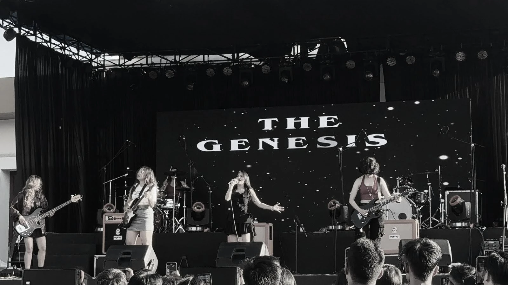
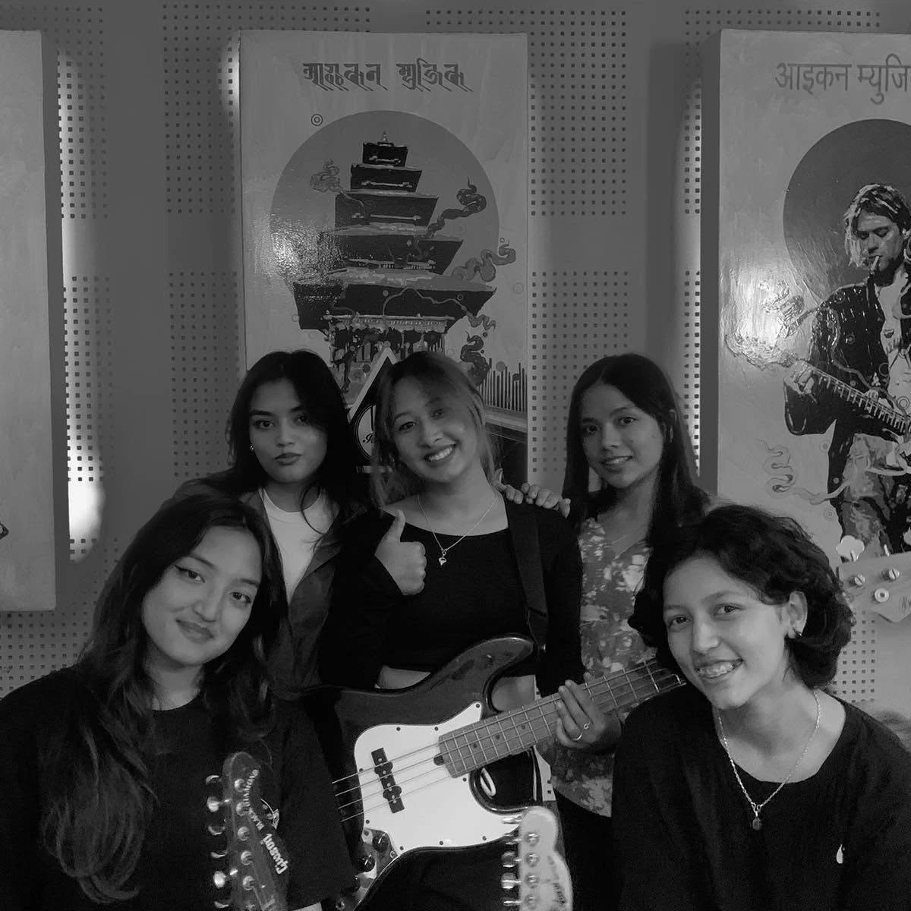
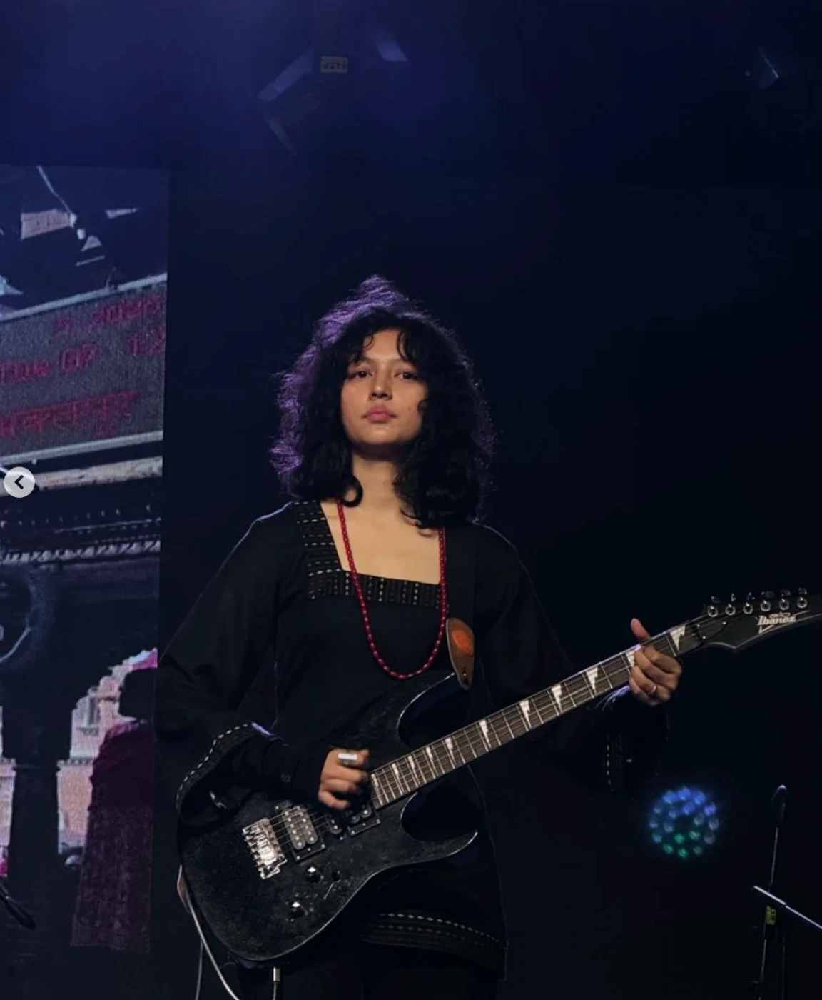
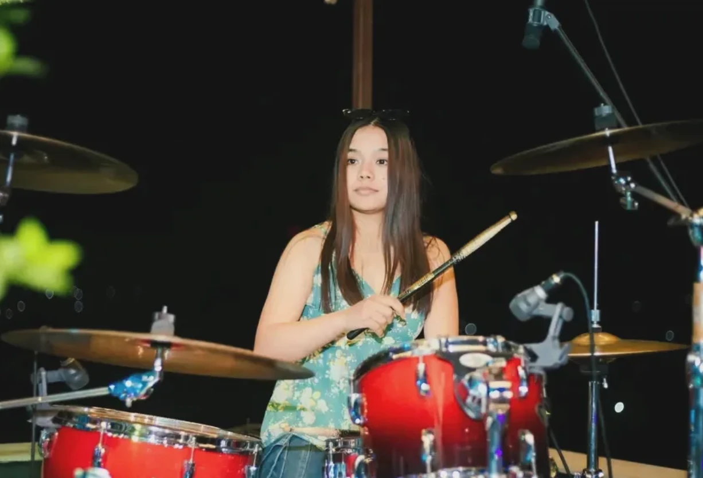
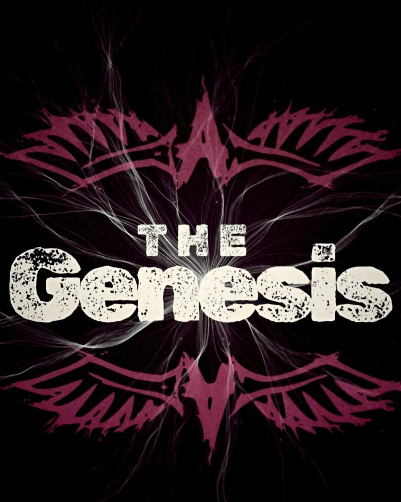

<p align="center">
  
</p>

<p align="center">
  
</p>

<h1 align="center">THE GENESIS 💛</h1>

<p align="center">
  <b>WOMEN-LED BAND · The BEGINNING ✨</b><br/>
  Bhaktapur, Nepal
</p>

<p align="center">
  <a href="https://thegenesis-ksus.vercel.app">Website</a> ·
  <a href="https://www.instagram.com/thegenesis_____">Instagram</a> ·
  <a href="https://www.tiktok.com/@the_genesis92">TikTok</a> ·
  <a href="https://www.facebook.com/profile.php?id=61567087036193">Facebook</a> ·
  YouTube (coming soon)
</p>

---

## About the band

The Genesis is a women-led rock band from Bhaktapur, Nepal. The name means “the beginning”, and that is what the band set out to be: five musicians on the mic, the guitars, the bass and the drums, taking the space on stage that women have always deserved.

The band plays **English rock and metal covers**: the songs they grew up on, played loud and played their way.

| | |
| --- | --- |
| **Based in** | Bhaktapur, Nepal |
| **Formed** | ____ |
| **Plays** | English rock & metal covers |
| **Line-up** | 5 members, all women |

## Line-up

<table>
  <tr>
    <td align="center" width="20%">
      <br/>
      <b>Aishworya Thapa</b><br/>
      Vocals<br/>
      <a href="https://www.instagram.com/aishworyathapa_/">@aishworyathapa_</a>
    </td>
    <td align="center" width="20%">
      <br/>
      <b>Sristi Shrestha</b><br/>
      Lead Guitar<br/>
      <a href="https://www.instagram.com/srist.shrestha/">@srist.shrestha</a>
    </td>
    <td align="center" width="20%">
      <br/>
      <b>Reeya</b><br/>
      Guitar<br/>
      <a href="https://www.instagram.com/a_vocaddho/">@a_vocaddho</a>
    </td>
    <td align="center" width="20%">
      <br/>
      <b>k_sus</b><br/>
      Bass<br/>
      <a href="https://www.instagram.com/k_sus0/">@k_sus0</a>
    </td>
    <td align="center" width="20%">
      <br/>
      <b>Sadikshya Bagale</b><br/>
      Drums<br/>
      <a href="https://www.instagram.com/sadikshya_bagale/">@sadikshya_bagale</a>
    </td>
  </tr>
</table>

<p align="center">
  
</p>

---

## The website

Official site of The Genesis: **https://thegenesis-ksus.vercel.app**

Pages: Home · About · Shows & Events · Music & Videos · Gallery (photo albums) · Contact & Bookings

Built with **Next.js 16**, **React 19**, **Tailwind CSS 4** and **Nodemailer** for the contact form. Hosted on **Vercel**.

```bash
npm install
cp .env.example .env.local   # fill in the SMTP details for the contact form
npm run dev                  # http://localhost:3000
```

### Quick edits

| To change… | Edit |
| --- | --- |
| Formed year, about text, members, social links | `lib/band.ts` |
| Shows / events | `lib/shows.ts` |
| YouTube videos | `lib/videos.ts` |
| Gallery: add a folder of photos | `public/gallery/<Album Name>/` |
| Icons & link-preview image | `npm run brand-assets` |

The full how-to (gallery, contact form, environment variables, SEO steps after deploying) is in **[SITE-GUIDE.md](SITE-GUIDE.md)**.

---

<p align="center">© The Genesis. All rights reserved.</p>
